# agent-clinical-inference

**An agentic clinical data pipeline: seven agents take raw medical data from ingestion to interpretable inference — with a deterministic state machine, local privacy, and a typed audit journal.**

An implementation of Shimgekar et al., ["Agentic AI framework for End-to-End Medical Data Inference"](https://arxiv.org/abs/2507.18115) (arXiv:2507.18115, UIUC/UIC, July 2025). The paper's pipeline is reproduced faithfully where it is exact (its rule-based column typing, its 0.6 matching threshold, its greedy one-to-one assignment) and deliberately adapted where Bala's stack and the paper's own limitations point elsewhere — every substitution is documented in the adaptation table below.

> **Not for clinical use.** This is a research demo on synthetic mock data. No real patient data, no real PHI, no clinical validation.

## Run it in your browser (local UI)

Run the full pipeline from a local web UI: pick a bundled synthetic dataset (fall-risk or anxiety) or upload your own CSV, press **Run pipeline**, and watch all seven agents work — matched model, accuracy / ROC-AUC, top explanations, and the full audit journal. Mock mode by default: no key needed.

Run the UI locally:

```bash
pip install -r web/requirements.txt
uvicorn web.app:app --reload   # http://127.0.0.1:8000
```

## Project structure

```
src/clinical_inference/
  prompts.py        all system prompts, as named constants (inspectable)
  agent.py          ClinicalInferenceAgent (Strands) + its three tools
  pipeline.py       the 7-agent pipeline, driven by the state machine
  state_machine.py  deterministic transitions + policy gates
  llm.py            LiteLLM wrapper (model pick, image headers; mock default)
  ingestion.py / anonymizer.py / features.py / matcher.py /
  preprocessing.py / inference.py   the pipeline steps
  registry.py       model registry (load/list)
  journal.py        typed run journal + report
  cli.py            command-line entrypoint
web/                FastAPI local UI (imports the package from src/)
tests/              pipeline, matcher, state machine, eval suites
```

## Architecture

```mermaid
flowchart LR
    IN["Input file\nCSV / XLSX / JSON / ZIP / image"]
    A1["1. Ingestion Identifier\nmagic-bytes sniffer\n+ ZIP recursive unpack"]
    A2["2. Data Anonymizer\nlocal regex PII masking\n**** + audit log"]
    A3["3. Feature Extraction\ntabular: column headers\nimage: modality → disease"]
    A4["4. Model-Data Matcher\nsynonym + token overlap\nthreshold 0.6, greedy 1-to-1"]
    A5["5. Preprocessing Recommender\npaper's exact column typing"]
    A6["6. Preprocessing Implementor\nexecutes the steps"]
    A7["7. Model Inference\nGBM + top-10 explanation"]
    OUT["predictions.csv\njournal.json\nreport.md"]

    IN --> A1 --> A2 --> A3 --> A4 --> A5 --> A6 --> A7 --> OUT
```



The flow is owned by a **deterministic state machine** — `INGEST → ANONYMIZE → EXTRACT → MATCH → PREPROCESS → INFER → EXPLAIN → DONE/FAILED` — not by a prompt. Strands Agents + LiteLLM (Gemini free tier) wrap the pipeline for conversation only: the LLM writes message text and picks among eligible models with a justification; it never decides a transition. Every agent step is logged to a typed run journal (`journal.json` + `report.md`).

**Policy-as-code gates** (enforced in code, before the step runs):
- Inference runs only on data that has been anonymized **and** matched to a registered model.
- Matching runs only on anonymized headers.
- Raw PII never reaches a model call or an LLM call.

## The 7 agents (paper Table I)

| # | Paper agent | This build | Module |
|---|---|---|---|
| 1 | Ingestion Identifier (`Ingestion_Classifier`) — Magika file-type detection, ZIP recursive unpack | Deterministic magic-bytes + extension sniffer (stdlib-first); same ZIP unpack | `ingestion.py` |
| 2 | Data Anonymizer (`Ingestion_Anonymizer`) — Google Cloud DLP, `****` masking | Local deterministic PII detection (regex + identifier columns), `****` masking, audit log of counts by type | `anonymizer.py` |
| 3 | Feature Extraction (`Ingestion_Selector`) — tabular headers; MedGemma modality → disease | Tabular headers (exact); image headers mock in v0.1, Gemini vision optional with `--live` | `features.py` |
| 4 | Model-Data Matcher (`Ingestion_Feature_Matcher`) — SapBERT 768-dim, cosine 0.6, greedy 1-to-1, LLM picks best | Synonym map + token-overlap scoring, threshold 0.6, greedy 1-to-1, LLM picks best; optional SapBERT path | `matcher.py` |
| 5 | Preprocessing Recommender (`Preprocessing_Recommender`) — rule-based typing, auto mode > 50 MB | The paper's exact typing rules (see below); auto mode > 50 MB | `preprocessing.py` |
| 6 | Preprocessing Implementor (`Preprocessing_Implementor`) — executes the steps | Executes: median/mode imputation, binary map, one-hot, standardization | `preprocessing.py` |
| 7 | Model Inference (`Model_Inferencer`) — Perpetual Booster GBM (small data), custom DL (large), fine-tuned DETR (images); SHAP/LIME top 10 | sklearn HistGradientBoosting (Perpetual Booster equivalent); SHAP if installed, else permutation importance, top 10; DETR is a clearly-marked stub in v0.1 | `inference.py` |

### The paper's exact column-typing rules (Agent 5)

Applied to each column's metadata (null/unique counts, dtype):
- **Binary** — exactly 2 unique values.
- **Categorical** — low unique values with short string lengths (this build: ≤ 10 unique, median string length ≤ 20 — the paper gives no numbers, so the thresholds are explicit and reviewable here).
- **Numerical** — numeric dtype **and** unique values > 0.8 × total rows.
- **Textual** — everything else.

Per-type recommendations: Binary → mode imputation + 0/1 map; Categorical → mode imputation + one-hot; Numerical → median imputation + standardization; Textual → dropped from model features (non-numeric) — see the limitations note on integer scores below.

### The paper's exact matching rules (Agent 4)

- Every required feature must match a dataset column with similarity ≥ **0.6**.
- Each dataset column is assigned to at most one required feature (**greedy** one-to-one: best pair first, then next).
- Among all eligible models, the LLM picks the best and justifies it.

## Adaptation table — paper vs this build

| Paper | This build | Why |
|---|---|---|
| Google ADK orchestration | Deterministic state machine + typed run journal | The LLM talks; code owns control flow. Same pattern as Bala's other agent repos. |
| Google Cloud DLP anonymizer | Local deterministic anonymizer (regex + identifier columns) | Fixes the paper's own limitation (Section V/VI): cloud anonymization sends sensitive data off-site and breaks data sovereignty. Nothing leaves the machine here. |
| Magika file-type detection | Magic-bytes + extension sniffer (stdlib) | Same job, no model download, fully reproducible offline. |
| SapBERT embeddings for matching | Synonym map + token-overlap scoring by default; SapBERT optional via `sentence-transformers` | Works offline with no download; the optional path keeps the paper's method available. |
| Perpetual Booster GBM | sklearn `HistGradientBoosting` (small-data tuned) | Same family, same job; defaults tuned for small data (see `inference.py`). |
| MedGemma vision | Gemini vision (`gemini/gemini-3.5-flash-lite`, free tier) with `--live`; mock otherwise | Same multi-stage job (modality → disease), different vision model. |
| Fine-tuned DETR polyp detection | Clearly-marked mock stub in v0.1 | No real DETR weights exist in this repo; faking a detection would be worse than none. Real weights are a future step. |
| Cloud-dependent throughout | Runs fully offline in mock mode | Directly addresses the paper's Section V limitation for low-resource / sovereignty-constrained settings. |

## How to run

```bash
git clone https://github.com/balasaikunapareddi/agent-clinical-inference.git
cd agent-clinical-inference
python3 -m venv .venv
.venv/bin/pip install -r requirements.txt
```

One command, no key, mock data only:

```bash
make demo            # fall-risk CSV, full pipeline, mock mode
make demo-anxiety    # anxiety CSV, full pipeline, mock mode
make demo-image      # image path (mock stub result)
make test            # full test suite
make list-models     # the registered model database
```

With Gemini for the LLM steps (model pick + image headers) — free tier, needs a key:

```bash
export GEMINI_API_KEY=...   # never commit it
make demo-live           # fall-risk with Gemini
make demo-anxiety-live   # anxiety with Gemini
make demo-image-live     # image with Gemini vision
```

Conversational layer (Strands agent — needs `GEMINI_API_KEY`):

```bash
make chat
```

Every run produces a directory under `runs/` with `journal.json` (every agent step: inputs, decisions, outputs), `report.md` (human-readable version of the same), and `predictions.csv` (structured model output with predicted label + probability).

## Evals

Verified 2026-11-17 (tests re-run, demos run by hand, live Gemini verified):

| Check | Result |
|---|---|
| Test suite | **54 passed** (unit tests per agent + e2e on both mock datasets) |
| `make demo` (fall-risk) | DONE — `fall-risk-gbm`, accuracy **0.68**, ROC-AUC **0.757** (150 train / 50 test) |
| `make demo-anxiety` | DONE — `anxiety-gbm`, accuracy **0.76**, ROC-AUC **0.739** (150 train / 50 test) |
| `make demo-live` (Gemini) | DONE — Gemini wrote the model-pick justification (verified in the journal) |
| `make demo-image-live` (Gemini vision) | Vision call verified in the journal (`source: gemini-vision`); the solid-color mock image honestly returned modality/disease `none`, and the pipeline failed cleanly at MATCH — no forced match |
| `make demo-image` (mock) | DONE — `polyp-detr`, explicitly-marked MOCK result |

Top features (fall-risk run): step-time variability, foot-pressure mean, gait speed — the gait features the paper's GSTRIDE work is built on.

## Mock data (no real PHI)

- `data/fall_risk_mock.csv` — 200 rows, GSTRIDE-style: gait speed, stride length, foot pressure, foot angle, ankle range of motion, step-time variability, fall history → `fell`.
- `data/anxiety_mock.csv` — 200 rows, palliative-care-style: age, gender, antidepressant use, vomiting, pain/fatigue scores, sleep, hope score → `anxiety_high` (and `low_hope` for the hope model).
- `data/colonoscopy_mock.png` — a solid-color placeholder frame for the image path.

All values are synthetic (seeded RNG). The PII columns (`patient_name`, `email`, `phone`, `mrn`, `dob`) are fake placeholders whose only purpose is to exercise the anonymizer — they are masked and dropped before matching or modeling. Regenerate with `scripts/make_mock_data.py`.

## Limitations

From the paper (Section V/VI), inherited:
- **Matching breaks on non-standard features.** Token-overlap (and SapBERT) matching fails when user headers are ambiguous or semantically distant from known clinical terms — the run then fails cleanly with "no registered model matches" rather than guessing.
- **The recommender is static.** Its rules do not learn from historical outcomes or model performance.
- **No formal evaluation standards.** No quantitative benchmarks or human-centered evaluation; nothing here is clinically validated.

Ours (this build):
- **Integer scores type as Textual.** Under the paper's literal rule, an integer column with few unique values (e.g. age in years, a 0–10 pain score as ints) is Textual, not Numerical. The recommender retains numeric Textual columns as numeric features (median imputation, no scaling) instead of dropping them — a documented interpretation, not a change to the classifier. The mock data uses continuous scores so the rule behaves sensibly.
- **Categorical thresholds are ours.** "Low unique values with short string lengths" has no numbers in the paper; we use ≤ 10 unique and median string length ≤ 20.
- **Name detection is column-name based.** The anonymizer masks name/identifier columns by name and regex for the rest; it has no free-text NER, so a name buried in a free-text note without a pattern match would not be caught. Do not feed real notes to it.
- **Image/DETR is a stub.** No real detection, no attention maps, no image redaction overlays in v0.1.
- **Small-data GBM.** The mock sets are 200 rows; the tuned booster settings are for small data, not a production-scale claim.

## Citation

```bibtex
@article{shimgekar2025agentic,
  title={Agentic AI framework for End-to-End Medical Data Inference},
  author={Shimgekar, Soorya Ram and Vassef, Shayan and Goyal, Abhay
          and Kumar, Navin and Saha, Koustuv},
  journal={arXiv preprint arXiv:2507.18115},
  year={2025}
}
```

Paper: https://arxiv.org/abs/2507.18115

## License

Apache-2.0 — see [LICENSE](LICENSE).
